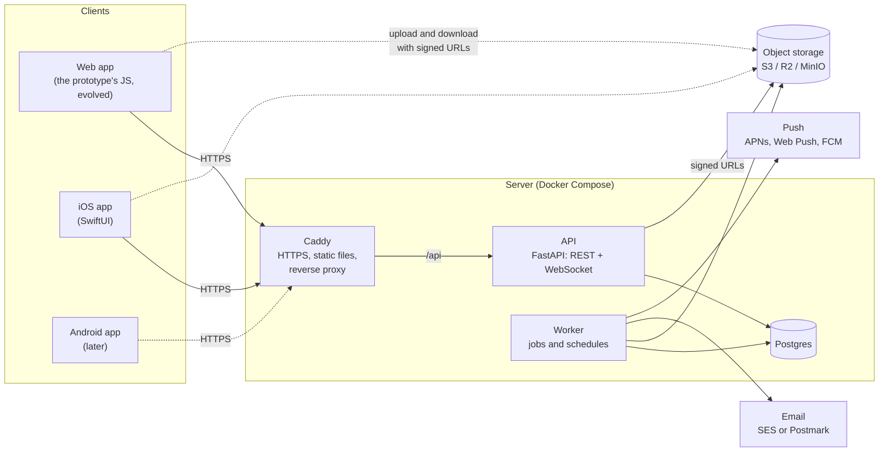
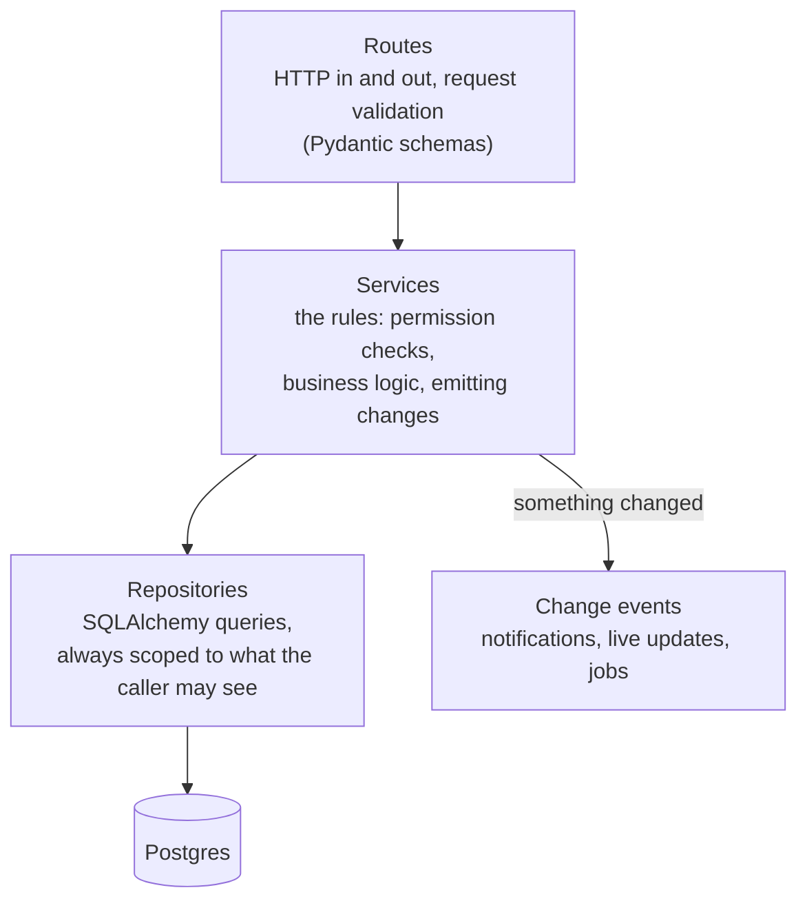
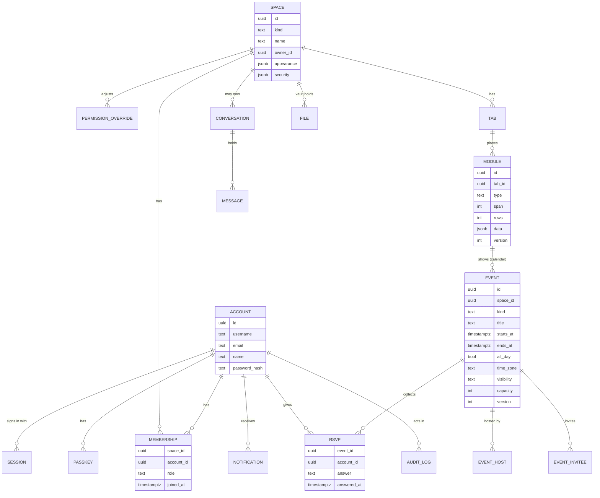
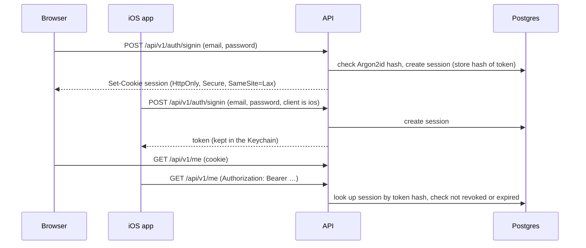
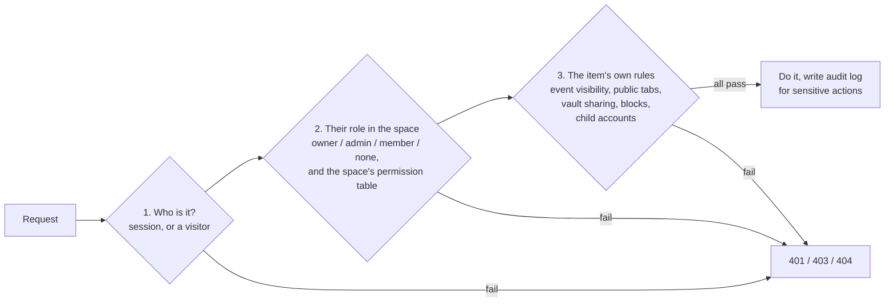
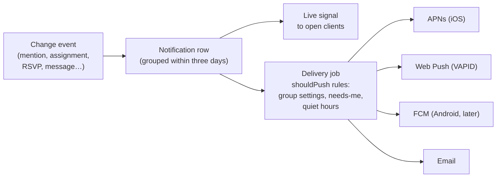
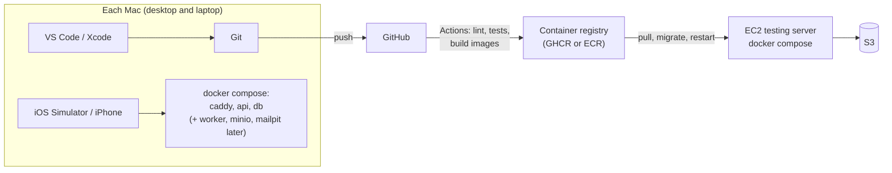

# 3den: architecture

Status: **first version for review** (Nov 20, 2026). Nothing in this doc is
built yet. It will change as the first build cycles teach us things.

Related docs:

- [proto_to_dev_plan.md](proto_to_dev_plan.md): the request this doc answers,
  and the open questions.
- [development_setup.md](development_setup.md): how to run all of this on a Mac.
- [dev_plan_1.md](dev_plan_1.md): the first build cycles.
- [infrastructure_review.md](infrastructure_review.md): hosting options and
  costs. This doc takes its recommendations as a starting point.
- `DESIGN.md` (repo root): the prototype's building blocks and design rules.
  Those rules still apply to the product; this doc is about how it's built.

---

## 1. Goals and constraints

- **Three platforms, one backend.** Web (responsive, phone first), an iOS app,
  and later an Android app all use the same HTTP API. No platform gets a
  private back door.
- **Docker everywhere.** The same containers run on your desktop, your laptop,
  and the EC2 testing server.
- **Small team.** One developer plus Claude. Prefer boring, well-documented
  tools and one codebase per platform over clever infrastructure.
- **Keep what the prototype got right.** Its data shapes, its permission
  table, and its design rules ("Undo instead of Are you sure", "Nothing is
  lost", "Private by default") carry into production.
- **Open source (AGPL-3.0-or-later).** Assume the repo will be public: no
  secrets or anti-abuse settings in it, and the server must link to its
  source.

## 2. The big picture



One **API** process serves every client. A **worker** (the same Python
codebase, started differently) does anything slow or scheduled. **Postgres**
holds the data, and also the job queue and the live-update signals at first,
so there are no extra services to run. **Caddy** sits in front: it serves the
web app's static files, handles HTTPS, and forwards `/api` to FastAPI, so the
browser sees one site (which keeps cookies simple and avoids CORS).

## 3. Decisions

| Area | Decision | Status |
|---|---|---|
| Backend language | Python 3.13, FastAPI, Uvicorn, SQLAlchemy 2, Pydantic, Alembic | Decided (this plan names FastAPI) |
| Database | Postgres 17 (same major version locally and on AWS) | Decided |
| Web server | Caddy in front of FastAPI, also serving the web app | Proposed |
| Web client | Evolve the prototype's framework-free JS; no rewrite | Proposed |
| iOS client | Native SwiftUI app talking to the same API | Proposed, see Question 1 |
| Android | Native Kotlin and Jetpack Compose, after iOS works | Later |
| API style | JSON over HTTPS, versioned under `/api/v1`, OpenAPI schema generated by FastAPI | Proposed |
| Sessions | Opaque, revocable session tokens: an httpOnly cookie on the web, a bearer token in the Keychain on iOS | Proposed |
| Sign-in | Email and password (Argon2id) first; passkeys next; never SMS codes | Proposed |
| Data model | Real tables for anything shared, checked, or queried; `jsonb` for each module's own data | Proposed (from infrastructure_review.md) |
| Jobs | Postgres-backed queue (Procrastinate or `SKIP LOCKED`) | Proposed |
| Live updates | WebSocket at `/api/v1/live`, Postgres LISTEN/NOTIFY between processes | Proposed |
| Files | Object storage with signed URLs; MinIO or Garage locally | Proposed |
| Testing server | One EC2 instance running Docker Compose, files on S3 | From your plan |

## 4. Clients

### 4.1 Web: the prototype becomes the product

The prototype was built to be split this way: everything it saves goes
through one file (`js/state/storage.js`), every permission check goes
through one function (`can()` in `js/state/permissions.js`), and views redraw
on store events rather than calling each other. So the web app is **not
rewritten**. Instead:

- **`storage.js` becomes the API client**, joined by small per-area client
  files (for example `js/api/events.js`).
- **`store.js` becomes a cache of server data.** A change shows on screen at
  once, is sent to the server, and is rolled back with a toast if the server
  refuses it.
- **Two modes.** *Demo mode* is today's prototype (IndexedDB and the sample
  data), kept for showing 3den off and for UI work. *Server mode* signs in to
  the API. Each area moves from demo data to server data one at a time
  (accounts first, then groups and events, and so on). Areas the server
  doesn't own yet keep working from local data in server mode, with a clear
  "not saved to the server yet" note while they're in between.
- It stays framework-free with no build step. Minifying and bundling
  (esbuild) can come later for production only.
- The sample data (`js/data/`, about 1.1 MB) is only loaded in demo mode. A
  seed script loads the same groups into Postgres for development.

### 4.2 iOS: a native SwiftUI app

- SwiftUI, iOS 18 and later, Swift concurrency (`async`/`await`), and
  `URLSession`. No third-party networking library.
- The Xcode project is generated from a small `project.yml` with
  [XcodeGen](https://github.com/yonaskolb/XcodeGen), so Claude can create and
  change it as text and it never conflicts in Git.
- **A phone-first subset, not every module.** The phone app does what people
  do on phones: Home (your week), a group's widgets and Up next, events and
  RSVPs, messages, notifications, and quick posting. The prototype's phone
  layout (tab bar, widgets, bottom sheets) is the design to follow.
- **Heavy modules open the web page.** Gantt, Budget, Sheet, Relationship map,
  and the editor are desktop-shaped. Until a native screen is worth building,
  the app opens the module's web page in an in-app web view, signed in with
  the same session.
- **API types are generated, not hand-written,** from the API's OpenAPI
  schema (Apple's `swift-openapi-generator`), so the app and the server
  can't quietly disagree.
- Push notifications go through APNs. That needs the paid Apple Developer
  Program (also needed for TestFlight).

### 4.3 Android (later)

Kotlin and Jetpack Compose, with the same scope as the iOS app and its API
types generated from the same OpenAPI schema. Firebase Cloud Messaging for
push. Nothing in the backend should be iOS-specific, so Android adds a client
and nothing else.

## 5. Backend

### 5.1 One service, split into areas

The API is a single FastAPI application (a "modular monolith"), not a set of
microservices. Each area of the product is its own Python package with the
same three layers:



```
prod/server/
  app/
    main.py            app setup, middleware, routers
    core/              settings, database, security helpers, errors
    auth/              sign-up, sign-in, sessions, passkeys
    accounts/          members, profiles, settings
    spaces/            groups, personal homepages, blogs, tabs, memberships, roles
    permissions/       the permission table and can()
    modules/           module records and their jsonb data
    events/            events, RSVPs, waitlists, series, calendar feed
    messages/          conversations and messages
    notifications/     the bell, delivery rules, push subscriptions
    social/            posts, comments, likes, friends, follows, the Feed
    files/             vault items, uploads, sharing
    search/            search and Explore
    safety/            reports, blocks, moderation, child accounts
    live/              the WebSocket
  worker/              job entry point and job definitions
  migrations/          Alembic
  tests/               pytest
```

Each area gets built when a build cycle needs it, not all at once.

### 5.2 Watchers move to the server

In the prototype, watchers notice changes and create notifications
(`watchAssignments()`, `notifyMentions()`, `watchGroupNews()`). On the
server, services emit **change events** ("task assigned", "event RSVP
changed", "message posted") inside the same database transaction as the
change. Handlers turn those into notification rows, live-update signals, and
delivery jobs. Modules still don't send notifications themselves, which is
the same rule the prototype follows.

### 5.3 Live updates

- One WebSocket per signed-in client at `/api/v1/live`.
- The client subscribes to the spaces and conversations it can see; the
  server checks each subscription.
- The server sends small "this changed" signals (`{type: "event", id, version}`),
  and the client fetches what it needs. That matches the store's existing
  events (`messages`, `notifications`, `layout`, and so on) and keeps private
  data off the socket.
- Between API processes, signals go through Postgres LISTEN/NOTIFY. Redis or
  Valkey only if that stops keeping up.

### 5.4 The worker

The worker runs the same code with a different entry point. Jobs: push and
email delivery (with the prototype's `shouldPush` rules: group settings,
"needs me" only, and quiet hours), reminders, scheduled articles and recaps,
repeating tasks, image and document previews, fetching outside calendars
(moved off the browser), and cleanup (disappearing messages, expired
invites, and expired sessions).

## 6. Data model

### 6.1 Tables or JSON?

Today every module keeps its data as one JSON object. The rule for the
server:

- **A real table** for anything the server must check, join, search, notify
  about, or share across spaces: accounts, sessions, spaces, memberships,
  roles, events, RSVPs, assignments, conversations, messages, notifications,
  posts, comments, likes, friends, follows, files and sharing, reports, blocks,
  and the audit log.
- **A `jsonb` column** on the module row for everything else: a Budget's
  lines, a Survey's questions, a List's items, a Sheet's cells. That lets most
  of the 25+ module types move to the server without their own tables.
- A module can move from `jsonb` to tables later, when a feature needs it.

### 6.2 Core tables



Conventions:

- **IDs are UUIDs** (version 7, which sort by time). Clients may make the ID
  for something new, so a phone can show it at once and retry safely.
- **Times are `timestamptz` in UTC.** Events also keep the time zone they
  were made in, so repeating events stay right across daylight saving, and
  clients show an event's times where it happens. All-day items run from
  midnight to the midnight after their last day, in that zone.
- **Events and calendar entries share a table** (`kind`: `event` has a page
  and RSVPs; `entry` is something to remember, like "Rent due"), as they
  share the prototype's calendar. Built in Cycle 4: `spaces`,
  `memberships`, `events`, `event_rsvps`, and `event_invitees`.
- **Every editable row has a `version`.** A save says which version it
  started from; if someone else saved first, the server answers
  `409 Conflict` and the client offers to reload or merge, instead of
  silently overwriting.
- **"Nothing is lost":** deletes set `deleted_at` (so Undo works and a
  removed module keeps a copy), and a cleanup job purges them later. Article
  edits keep earlier versions in a history table.
- **Alembic** replaces `DATA_VERSION` and `MIGRATIONS` (`js/state/upgrade.js`)
  for server data. Migrations run as a separate step before new code starts.

## 7. API

- JSON over HTTPS, under `/api/v1`. Resources follow the product:
  `/me`, `/spaces/{id}`, `/spaces/{id}/members`, `/modules/{id}`,
  `/events/{id}`, `/events/{id}/rsvp`, `/conversations/{id}/messages`,
  `/notifications`, `/files/{id}`.
- **OpenAPI** is generated by FastAPI at `/api/openapi.json`, with
  interactive docs at `/api/docs` in development. A copy is kept in
  `prod/shared/openapi.json` (`make openapi`; a test fails when it's out of
  date), and the iOS (later Android) types are generated from it, with
  Apple's swift-openapi-generator. Optional fields are described as plainly
  optional (`app/core/openapi.py`) so the generated types are simple.
- **Errors** use one shape, `{"detail": "a sentence to show"}` (FastAPI's
  own), declared in the OpenAPI document, so every client shows them the
  same way. (`application/problem+json`, with `type` and `title`, can
  replace it later if clients need to tell errors apart beyond the status.)
- **Lists are paged** with a cursor (`?after=<cursor>&limit=50`), not page
  numbers, so new items don't shift pages.
- **Retries are safe.** Creates accept an `Idempotency-Key` header (or a
  client-made ID), because phones lose connections mid-request.
- **One "home" call per screen** where it helps (for example
  `GET /api/v1/spaces/{id}/home` returns a group's tabs, modules, and the
  first page of each module's items), so phones make one request instead of
  twenty.

## 8. Identity, access control, and security

### 8.1 Signing in



- **Sessions are opaque random tokens**, stored only as a hash, with the
  device name and last use. That's what the Security tab's device list
  shows, and any session can be revoked at once. (Self-contained JWTs are
  hard to revoke, so they're not used.)
- **Web:** an httpOnly, Secure, SameSite=Lax cookie that page scripts can't
  read. Requests that change things must also pass an `Origin` check, which
  together with SameSite blocks cross-site request forgery.
- **iOS and Android:** the same session, sent as a bearer token and stored in
  the Keychain (Android: the Keystore).
- **Passwords** are hashed with Argon2id on the server (the prototype's
  browser-side SHA-256 goes away).
- **Passkeys** (WebAuthn) come next and become the main way in, as the
  prototype's Security tab promises. They work on the web and on iOS
  (`AuthenticationServices`). Emailed sign-in links cover account recovery.
  **No text-message codes**, matching the design rule.
- **Rate limits from day one** on sign-in, sign-up, password reset, invites,
  uploads, and the calendar feed.

### 8.2 Who can do what

Every request goes through three checks, in order, all on the server. The
client's own checks (the prototype's `can()`) only decide what to show; they
are never trusted.



- **The permission table is shared.** The prototype's `ROLES` and
  `PERMISSIONS` (each permission and the lowest role allowed) move into one
  file, `prod/shared/permissions.json`, read by both the web app and the server.
  A shared file of test cases ("a member may post on the board; a member may
  not pin") runs in both the JS checks and pytest, so the two can't drift.
- **Queries are scoped, not filtered afterwards.** Repositories only ever ask
  for rows the caller can see (for example "events in spaces I'm a member
  of, or public events"). Search and Explore follow the same rule.
- **Not found beats forbidden.** For private things, a 404 is returned
  instead of a 403, so the API doesn't reveal that a private group or event
  exists.
- **Visitors** (not signed in) can read public tabs, public events, and
  public blogs, and nothing else.
- **Sensitive actions are audited:** role changes, ownership transfer,
  removing members, deleting a group, moderation, and security setting
  changes.
- **Later, as a safety net:** Postgres row-level security on the most
  private tables, so a forgotten check in code still can't leak data.

### 8.3 Protecting data

- **In transit:** HTTPS everywhere (Caddy gets certificates automatically).
- **At rest:** encrypted disks and buckets (RDS or EBS encryption, S3
  encryption).
- **End-to-end encryption:** direct messages move to the Signal protocol and
  group chats to MLS, with the server holding only public keys and ciphertext.
  This is research-heavy and comes late (see Prioritization). See Question 5
  about encrypted groups.
- **Privacy by default, carried over:** rough area instead of exact
  location; uploads re-encoded on the server too (dropping embedded
  location and camera data); calendar feed tokens stored hashed and
  revocable; no message or post text in logs; notification previews off
  unless the person turns them on.
- **Your data is yours:** export and account deletion endpoints before the
  pilot opens to people you don't know.

### 8.4 Running it safely

- **Secrets** live in `.env` files that are never committed (an
  `.env.example` is), and later in AWS SSM Parameter Store. This includes
  anti-abuse settings, because the repo will be public.
- **Dependencies** are pinned (`uv.lock`, `Package.resolved`) and checked by
  Dependabot.
- **Containers** run as a non-root user, and only Caddy is reachable from
  outside the server.
- **Backups:** nightly database dumps to S3 on the testing server, and a
  practice restore before real people's data is on it.

## 9. Files and media

1. The client asks the API for a signed upload URL (the API checks the
   vault's permissions first).
2. The client uploads straight to object storage.
3. The client confirms; the API records the file, and the worker makes
   previews and strips metadata.
4. Downloads use short-lived signed URLs, issued only after the vault's
   sharing rules allow it.

Locally, MinIO or Garage stands in for S3 (check MinIO's license and status
first). On EC2, S3; later perhaps Cloudflare R2, which doesn't charge for
data sent out.

## 10. Notifications and delivery



The bell's list, phone notifications, and emails all come from the same
notification rows, so they never disagree.

## 11. Environments and deployment



- **Local:** source code is mounted into the containers and the API reloads
  on save, so you rarely rebuild images. Each Mac has its own database, filled
  by the same seed script. GitHub is how the two Macs stay in sync.
- **Testing (later):** GitHub Actions builds images; the EC2 server pulls them,
  runs migrations, and restarts. Cloudflare Access or a similar gate keeps
  it private.
- **Production:** decided later, from infrastructure_review.md's options.

## 12. Testing

- **pytest** for the API, including an allowed and a denied test for every
  permission.
- **The existing Playwright tests** keep running against demo mode, and new
  ones run against server mode through Caddy.
- **XCTest** for the iOS app's networking and decoding, and a few UI tests.
- **Contract:** the OpenAPI schema is checked into the repo, so a change to it
  shows up in review.

## 13. From prototype to production, area by area

Priority: **P0** is the first build cycles, **P1** is before a pilot with
people you know, **P2** is before opening to people you don't know, and
**P3** is later.

| Area | Prototype today | Production | Priority | iOS |
|---|---|---|---|---|
| Hello World | — | Caddy, FastAPI, Postgres, Alembic, the iOS app, end to end | P0 | Yes |
| Accounts and sign-in | `accounts.js`, browser hashing | Accounts, sessions, Argon2id; passkeys next | P0 | Yes |
| Groups, memberships, roles | `groups.js`, `permissions.js` | Tables, the shared permission table, invites | P0 | Yes |
| Events and RSVPs | in Calendar module data, `events.js` | Event, RSVP, host, and waitlist tables | P0 | Yes |
| Homepages, tabs, modules, editor | `store.js` spaces and modules, `js/editor/` | Tab and module rows, `jsonb` data, versioned saves | P1 | Widgets only; editor on the web |
| Up next and Home (Dashboard) | `upnext/`, `dashboard/`, linked items | Server-built "home" responses | P1 | Yes |
| Tasks, List, assignments | `todo/`, `kanban/`, `grocery/` | Module `jsonb` plus an assignments table | P1 | Yes |
| Board and Forum | `announcements/`, `forum/` | Posts and comments tables | P1 | Yes |
| Messages and Chat | `messages.js`, `live.js` | Conversations, messages, the WebSocket | P1 | Yes |
| Notifications and delivery | `notifications.js`, `delivery.js`, `sw.js` | Notification rows, worker, APNs, Web Push, email | P1 | Yes |
| Calendar feed | `calendar-feed.js` | `GET /cal/<token>.ics` | P1 | — |
| Vault and files | `vault/`, browser storage | Object storage, signed URLs, previews | P1 | View, upload photos |
| Appearance | CSS custom properties per space | `jsonb` on the space; iOS reads the same values | P1 | Accent and fonts |
| Onboarding and invites | `onboarding/`, `#join-<code>` | Invite tokens, sign-up flows, universal links | P1 | Yes |
| Feed, blogs, friends, follows, likes | `feed/`, `follows.js`, `friends.js` | Social tables, public blog pages | P2 | Feed and likes |
| Search and Explore | `search.js`, `explore.js` | Postgres full-text search, scoped to what you can see | P2 | Yes |
| Safety | `reports.js`, `blocks.js`, `children.js` | Reports, blocks, moderation queue, child accounts | P2 (blocking and reporting in P1) | Yes |
| Security settings | `security.js`, Security tabs | Enforced: passkey requirements, history limits, invite expiry, disappearing messages | P2 | Yes |
| Budget, Gantt, Sheet, Survey, Submissions, Relationship map, Volunteer shifts | each module folder | Module `jsonb`; tables only where needed | P2 | Web view |
| Bring your people, Instagram connect | `bring.js`, `instagram.js` | Contact matching on the server (hashed); Instagram needs Meta's approval | P3 | Contacts |
| Maps and address search | OpenFreeMap, CDN MapLibre | Protomaps on own storage, bundled MapLibre, Photon | P3 | MapKit or MapLibre |
| End-to-end encrypted messages | `e2ee.js` (simulated) | Signal protocol (direct), MLS (groups) | P3 | Yes |
| Android app | — | Kotlin and Compose client | P3 | — |

HANDOFF.md asks that four things be raised before any server code is
written. They're placed here: the **calendar feed** (P1), **Web Push** (P1),
**AGPL readiness** (P2, before the repo is public: full license text, real
contact addresses, `SOURCE_CODE_URL`, DCO or CLA, and the trademark), and
**Protomaps** (P3).

## 14. Risks and open questions

- **Three clients is a lot for one developer.** Keeping iOS to a phone-first
  subset, opening heavy modules as web pages, and generating API types are
  the main defenses. Android waits until the API settles.
- **Two copies of the rules.** Permission and data rules exist in JS and
  Python. The shared permission file and shared test cases limit the drift.
- **The prototype's store assumes everything is local and instant.** Moving
  areas to server mode one at a time needs care at the seams. The first
  cycle (events) will show how much.
- **Encrypted groups.** The prototype's group Security tab defaults to
  encrypting private posts, chat, calendar, and vault. Server-side search,
  Explore, notifications, and permission checks on content don't work on
  data the server can't read. See Question 5 in proto_to_dev_plan.md.
- **Not yet checked against** the "Security, privacy, and anti-bot plan" doc
  linked from HANDOFF.md, which couldn't be opened from here.
